  

  
  

## About

I build software in Bengaluru, and I'm currently working on something new in stealth.

My background is in Android. Since 2016 I have built apps ranging from VIT University's official yearbook to an ECG signal-processing pipeline, and I'm still drawn to problems that sit close to the device. Today I work mostly in TypeScript, Next.js and Supabase, building small, focused products that do one thing well.

Alongside that, I build developer tooling for AI assistants and occasionally rework hardware I own. Most recently, I turned a Xiaomi Google TV into a console-style living-room setup.

## Selected work

<table>
  <tr>
    <td width="50%" valign="top">
      <h3><a href="https://github.com/abhinav-adtechs/argon">Argon</a></h3>
      
Debloated Xiaomi Google TV with a PS5-style launcher and a phone/laptop web remote.

      
      
      
    </td>
    <td width="50%" valign="top">
      <h3><a href="https://github.com/abhinav-adtechs/life-is-short">Life is Short</a></h3>
      
Do the one thing that matters right now. <a href="https://life-is-short-pi.vercel.app">Live ↗</a>

      
      
      
    </td>
  </tr>
  <tr>
    <td width="50%" valign="top">
      <h3><a href="https://github.com/abhinav-adtechs/PanTompkins-Android">PanTompkins-Android</a></h3>
      
The classic Pan–Tompkins QRS-detection filter pipeline, streaming ECG on Android.

      
      
      
    </td>
    <td width="50%" valign="top">
      <h3><a href="https://github.com/abhinav-adtechs/Claude-Backup">Claude-Backup</a></h3>
      
Back up every Claude Code &amp; Cowork session to a markdown vault — resume from any account.

      
      
      
    </td>
  </tr>
  <tr>
    <td width="50%" valign="top">
      <h3><a href="https://github.com/abhinav-adtechs/CGPAAmortizedAnalysis">CGPA Amortized</a></h3>
      
Know the GPA you need next semester to hold a 9.0 CGPA — worked out amortized-analysis style.

      
      
      
    </td>
    <td width="50%" valign="top">
      <h3><a href="https://github.com/abhinav-adtechs/fifa-league-tracker">FIFA League Tracker</a></h3>
      
Track your friends' FIFA / EA FC league. <a href="https://fifa-league-tracker.vercel.app">Live ↗</a>

      
      
      
    </td>
  </tr>
</table>

<b>Earlier work (2015–2019)</b>

 

| Project                                                                               | What it is                                                           |
| ------------------------------------------------------------------------------------- | -------------------------------------------------------------------- |
| [Yearbook-Android-Client](https://github.com/abhinav-adtechs/Yearbook-Android-Client) | The official Yearbook app of VIT University                          |
| [Code-To-Create](https://github.com/abhinav-adtechs/Code-To-Create)                   | Website for ACM-VIT's first ever hackathon                           |
| [MinMaxKmeans](https://github.com/abhinav-adtechs/MinMaxKmeans)                       | Implementation of the MinMax k-Means clustering paper                |
| [AndroidAccessibility101](https://github.com/abhinav-adtechs/AndroidAccessibility101) | Understanding accessibility services and custom accessibility events |

## Stack

   
  

## Activity

  <picture>
    <source media="(prefers-color-scheme: dark)" srcset="https://github-readme-activity-graph.vercel.app/graph?username=abhinav-adtechs&theme=react-dark&bg_color=0D1117&color=A78BFA&line=22D3EE&point=FFFFFF&area=true&hide_border=true">
    
  </picture>

---

  <i>peace and digital computers.</i>

